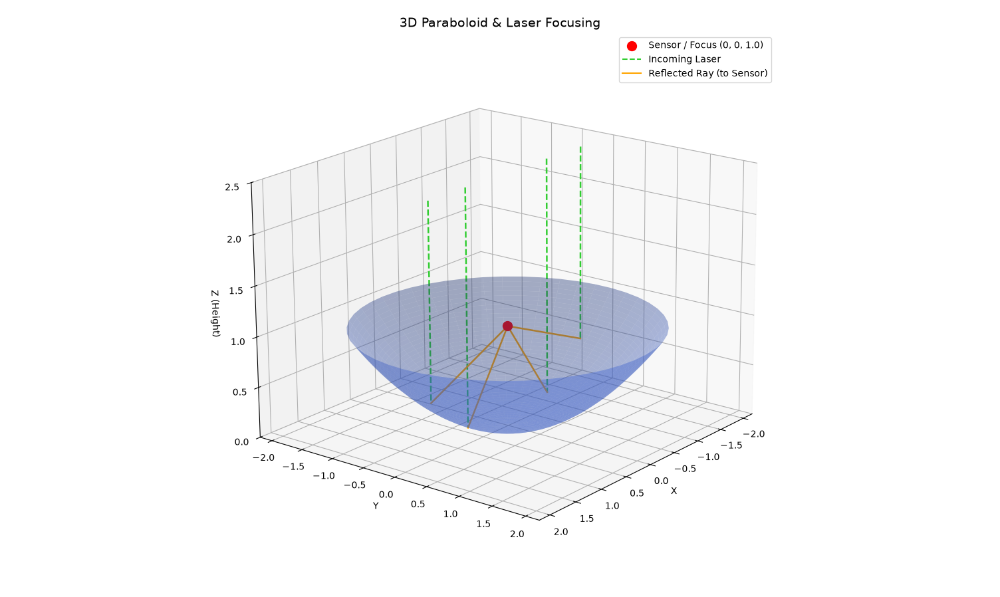

# School Cultural Festival IoT Ecosystem

A Next.js web app for cultural-festival ticketing, a live target game, and score rankings. Firebase Realtime Database synchronizes ticket and game data with the browser and the connected hardware client.

## Features

- Visitors can issue and cancel queue tickets and see active calls.
- Staff can manage tickets and reset festival data from the protected admin page at `/tickets/admin`.
- Players can join a target game with a room code and follow their score live.
- Players prepare a game from one screen. The page displays the live score written by the Raspberry Pi Pico WH integration.
- Visitors can view the live leaderboard.

## Project Structure

```text
app/                  Next.js routes, shared layout, styles, and Firebase client
	tickets/            Visitor ticket page and staff admin page
	shooting-game/      Player game page
	realtime-ranking/   Live leaderboard page
docs/                 Project notes and admin security setup
public/               Audio and other static assets
database.rules.json   Realtime Database access rules
firebase.json         Firebase CLI configuration
```

Next.js and TypeScript configuration files, package manifests, and lint settings live at the project root. Build output and installed dependencies are excluded by `.gitignore`.

## Development

Install dependencies and start the local server:

```bash
npm install
npm run dev
```

Open [http://localhost:3000](http://localhost:3000). Check the project with `npm run lint` and `npm run build`.

## Firebase and Admin Setup

The staff page uses Firebase Authentication and an administrator UID allowlist. Enable the Email/Password and Anonymous providers, configure `NEXT_PUBLIC_ADMIN_UID`, and deploy the Realtime Database rules before use. Follow [docs/admin-security.md](./docs/admin-security.md); do not deploy `database.rules.json` while it still contains the UID placeholder.

## Target Game

Open `/shooting-game`, enter a player name, and prepare the game. The page displays score changes written by the Pico WH and saves the final score to the leaderboard when the game ends; it has no manual score control. Configure a dedicated Firebase Email/Password account on the Pico. Its firmware can discover a room with `status: "playing"` and update `/game_pins/{roomId}/score` by +10 through the Realtime Database REST API. Replace `REPLACE_WITH_PICO_UID` in the rules with that account's UID. Pico firmware is not included in this repository.

The optional PyQt5 client in `app/laser_game.py` is a passive room and score monitor; it does not add points. Its dependencies are listed in `app/requirements-laser-game.txt`; it requires a separately managed Firebase service-account JSON file and the `FIREBASE_SERVICE_ACCOUNT_PATH` environment variable. Keep that private key outside the repository.

## Hardware & Optical Engineering Highlights
To reliably detect laser hits on a moving target under budget and physical constraints, the hardware system underwent several engineering iterations:

* **Microcontroller Selection (Edge Optimization):** Migrated from an entry-level educational board (Studuino) to a **Raspberry Pi Pico WH** (OS-less / MicroPython) to eliminate OS scheduling overhead and minimize latency, offloading sensor processing from the browser to the edge.

* **Mathematical Optical Design:** Because a single convex lens failed to maintain focus across varying target distances—and commercial parabolic mirrors exceeded budget—I mathematically calculated the focal length of a **quadratic curve (parabola)**, modeled the reflector in 3D CAD, printed it using a 3D printer, and lined it with aluminum foil to achieve reliable diffuse reflection.

  
  > **Figure:** 3D ray-tracing simulation (Python/Matplotlib) verifying optical convergence onto the sensor at focal point `(0, 0, 1.0)`.

* **Rapid Prototyping:** Following the cultural festival, the digital queue ticketing module (`/tickets`) was designed and implemented within **one day** to eliminate paper waste and streamline visitor flow.

* **Hardware Reliability & Safety (Field Maintenance):** During live operation at the cultural festival, standard electrical insulation tape repeatedly peeled off under mechanical stress, requiring frequent emergency repairs. To prevent short circuits and improve mechanical durability, I upgraded the wiring insulation to **heat-shrink tubing**.

# Universal Taxonomy of Knowledge: A 25-Domain Meta-Learning Platform

A structured, hierarchical web platform designed to deconstruct human knowledge into **25 foundational academic domains** and systematically synthesize them into **applied, interdisciplinary patterns**.

---

## Core Philosophy: Orthogonal Decomposition of Knowledge
Traditional academic classifications often suffer from ambiguity because they conflate **what** is being studied (the object of inquiry) with **how** it is studied (the methodology). 

To eliminate this ambiguity, this system classifies all human knowledge along two orthogonal axes: **Object vs. Methodology**. Through this lens, academic disciplines are strictly decomposed into **25 atomic domains** grouped into three structural tiers:

1. **Pure Core (16 Domains):** Disciplines where the object of inquiry and the methodology are completely aligned without structural overlap.
2. **Boundary / Hybrid Domains (6 Domains):** Disciplines situated at the interface of two distinct paradigms, where the *object* belongs to one domain while the *methodology* belongs to another.
3. **Applied Intervention Foundations (3 Domains):** Disciplines that go beyond observation and explanation to actively *intervene in and reshape* the physical or social world.

---

## The 25 Foundational Domains (Taxonomy)

### Tier 1: Pure Core (16 Domains)
Consistent alignment between object and methodology.

* **Formal Sciences** *(Abstract symbols, logic, and formal rules)*
  1. **Logic**
  2. **Mathematics**
  3. **Statistics**
  4. **Computer Science**
* **Natural Sciences** *(Physical laws of matter, energy, and life)*
  5. **Physics**
  6. **Chemistry**
  7. **Biology**
  8. **Geology / Earth Science**
  9. **Astronomy**
* **Humanities** *(Human meaning, values, and textual/artistic expression)*
  10. **Philosophy**
  11. **Ethics**
  12. **Literature**
  13. **Art Studies** *(Systematic analysis of artistic works and expression)*
  14. **Aesthetics** *(Philosophical inquiry into beauty, taste, and value)*
* **Social Sciences** *(Institutions, power, and collective human behavior)*
  15. **Sociology**
  16. **Political Science**

*(Note: Art Studies and Aesthetics were explicitly separated to distinguish empirical/historical analysis of works from philosophical value judgment, forming a symmetric $5 \times 5$ matrix of 25 domains.)*

### Tier 2: Boundary / Hybrid Domains (6 Domains)
Defined by the structural tension between their object of study and their primary methodology.

| Domain | Interface (Object × Methodology) | Structural Rationale |
| :--- | :--- | :--- |
| **17. Linguistics** | Humanities × Formal Science *(+ Social)* | Studies human language (Humanities), yet models syntax and semantics using formal rules and mathematical structures (Formal Science). |
| **18. Psychology** | Natural Science × Social Science | Bridges neurobiology/perception experiments (Natural Science) and interpersonal/group dynamics (Social Science). |
| **19. Cultural Anthropology** | Humanities × Social Science *(+ Natural)* | Combines hermeneutic interpretation of culture/myths (Humanities) with structural analysis of kinship/exchange (Social Science). |
| **20. History** | Humanities × Social Science | Ranges from philological interpretation of texts (Humanities) to cliometrics and demographic modeling (Social Science). |
| **21. Economics** | Social Science × Formal Science | Addresses societal resource allocation (Social Science) primarily through mathematical optimization and econometrics (Formal Science). |
| **22. Law** | Social Science × Humanities | Designs institutional rules and conflict resolution (Social Science) via rigorous textual/hermeneutic interpretation (Humanities). |

### Tier 3: Applied Intervention Foundations (3 Domains)
Bridging fundamental science with real-world physical and societal intervention.

| Domain | Structural Position | Nature of Intervention |
| :--- | :--- | :--- |
| **23. Medicine** | Natural Science × Clinical Practice | Built on Biology and Chemistry, driven by the ethical and practical imperative to diagnose and heal. |
| **24. Engineering** | Natural Science × Formal Science × Design | Applies Physics and Mathematics to design and construct artificial systems not found in nature. |
| **25. Agriculture** | Natural Science × Social Science × Practice | Integrates Biology and Earth Science with economics and environmental management for food production. |

---

## System Architecture & Learning Model

### 1. Hierarchical Directory Structure (Current Implementation)
* **Unified Overview:** All 25 foundational domains are accessible from a single top-level overview interface, allowing learners to grasp the entire map of human knowledge at a glance.
* **Intuitive Folder Hierarchy:** Each domain is organized into a clean, predictable directory tree, separating core axioms, methodologies, and historical context.

### 2. Combinatorial Synthesis of Applied Fields (In Development)
Just as complex molecules are synthesized from elements in the periodic table, this platform treats **Applied Sciences** as systematic combinations (patterns) of the 25 foundational nodes:

* **Example A (Computational Physics / Optical Simulation):**
  `[02. Mathematics] + [04. Computer Science] + [05. Physics] + [24. Engineering]`
* **Example B (Natural Language Processing / Computational Linguistics):**
  `[01. Logic] + [04. Computer Science] + [17. Linguistics]`
* **Example C (Computational Neuroscience):**
  `[04. Computer Science] + [07. Biology] + [18. Psychology]`

---

## Development Roadmap
* [x] **Phase 1: Taxonomy Definition** — Formalize the 25-domain classification system based on object-methodology orthogonality.
* [x] **Phase 2: Core Hierarchy & Overview UI** — Implement the folder-based directory structure and unified single-page overview.
* [ ] **Phase 3: Combinatorial Pattern Engine** — Build data models (JSON/Graph) to map and generate interdisciplinary applied fields from foundational combinations.
* [ ] **Phase 4: Interactive Knowledge Graph** — Enable learners to traverse prerequisites and cross-domain connections visually.

---

## Author's Note
This project is driven by a desire to move beyond fragmented, memorization-heavy curricula and explore the underlying structural unity of mathematics, language, natural sciences, and engineering.


## Project Notes

Architecture decisions and AI collaboration notes are in [docs/prompts.md](./docs/prompts.md).
